# Отчет по лабораторной работе №2

**Тема:** Исследование регулярных языков, построение конечных автоматов и лемма о разрастании в среде JFLAP

**Вариант:** 13

**Выполнил:** Козелков Дмитрий Игоревич КИ24-16/1Б

---

## 1. Цель работы

Изучение регулярных языков, способов построения эквивалентных регулярных выражений, конечных автоматов и регулярных праволинейных грамматик, а также применение леммы о разрастании (Pumping Lemma) для доказательства нерегулярности языков в среде JFLAP.

---

## 2. Задание

Вариант 13: Язык $L_{13}$ над алфавитом {0, 1} такой, что все строки
заканчиваются на 010.

1. **Часть 1:** Необходимо с использованием системы JFLAP построить регулярное
   выражение, описывающее заданный язык, или формально доказать
   невозможность этого. Привести обобщенный граф переходов и эквивалентный
   КА, а также пошаговое выполнение преобразований.
2. **Часть 2:** Необходимо с использованием системы JFLAP, построить регулярную
   грамматику, описывающую заданный язык, или формально доказать
   невозможность этого. Привести эквивалентный КА и РВ, а также пошаговое
   выполнение преобразований.

3. **Часть 3:** Доказать формально принадлежность или непринадлежность
   заданных языков к классу РЯ с использованием леммы о разрастании
   регулярных языков (Язык $L_{39}$ = {$0^n$ $1^m$ $2^n$ | n и m – произвольные неотрицательные целые
   числа}.)

---

## 3. Файлы работы

- `RE.jff` — исходное регулярное выражение (Часть 1)

- `RG.jff` — праволинейная грамматика (Часть 2)

---

## 4. Часть 1. Преобразование регулярного выражения в конечный автомат

### 4.1. Построение регулярного выражения

Язык $L_{13}$ над алфавитом {0, 1} такой, что все строки
заканчиваются на 010.

Математическая запись регулярного выражения:
$$(1+0)^*010$$

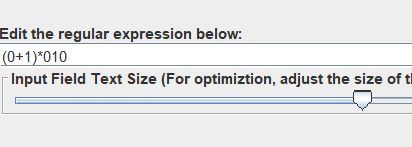

---

### 4.2. Пошаговое построение конечного автомата

Преобразование регулярного выражения в автомат выполняется путем последовательного раскрытия базовых операций (конкатенация, объединение, замыкание Клини):

1. Исходный обобщенный граф переходов с одной дугой:

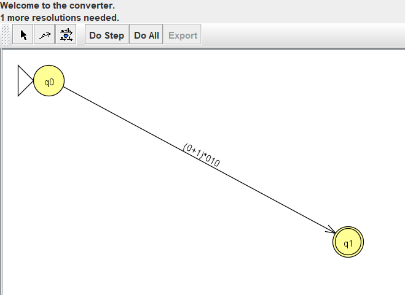

2. Пошаговое раскрытие конкатенаций и скобочных выражений:

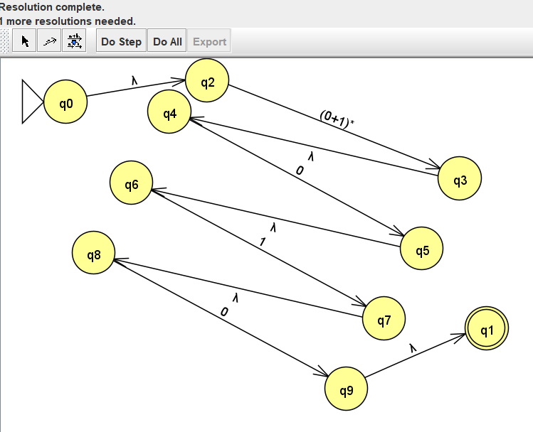
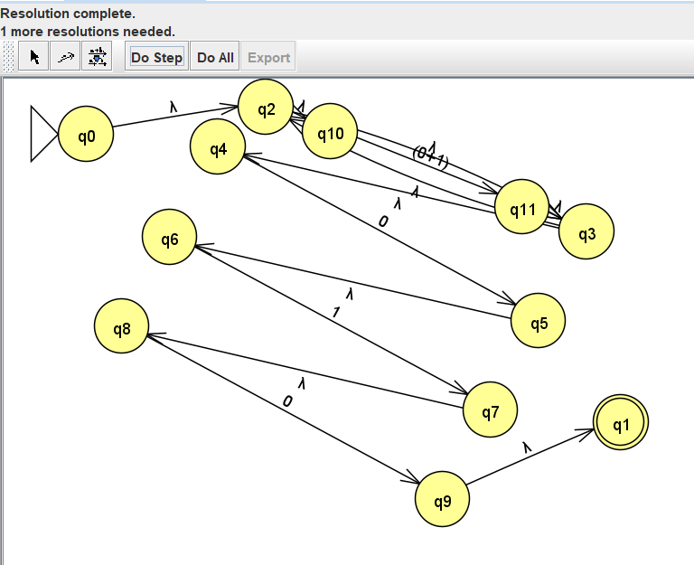
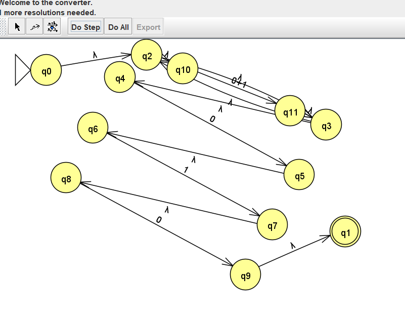

3. Итоговый построенный конечный автомат с $\lambda$-переходами:

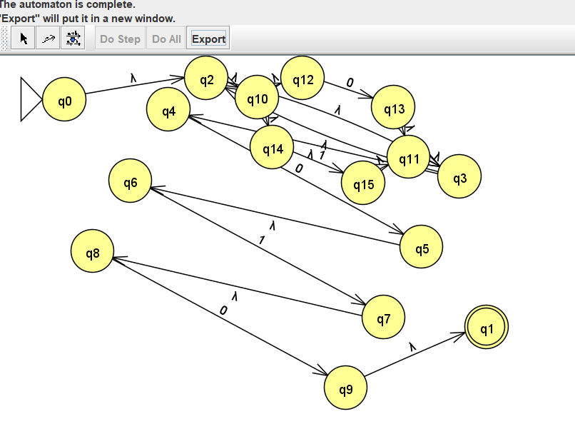

---

### 4.3. Тестирование автомата

Проверка работы автомата проведена в режиме **Input $\to$ Multiple Run**.

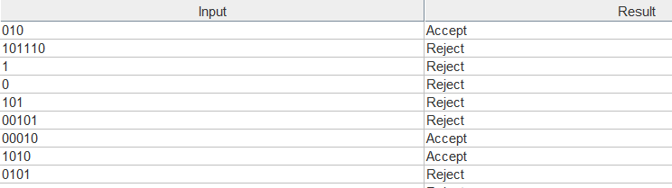

---

## 5. Часть 2. Преобразование регулярной грамматики в КА и обратное получение РВ

### 5.1. Построение праволинейной грамматики

Для языка $L_{13}$ составлена следующая праволинейная грамматика:

- $S \to 0S | 1S | 0A$
- $A \to 1B$
- $B \to 0$

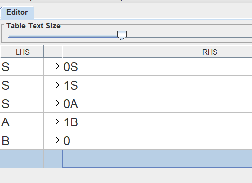

---

### 5.2. Построение КА по грамматике (Convert to FA)

Преобразование выполнено по стандартному алгоритму:

- Каждому нетерминалу сопоставлено состояние автомата ($S \to q_0, A \to q_1, \dots$);
- Правила вида $A \to aB$ преобразуются в переход по символу $a$ из $q_A$ в $q_B$;
- Правила с завершением цепочки ($A \to \lambda$, $F \to b$) направляются в выделенное финальное состояние $q_n$.

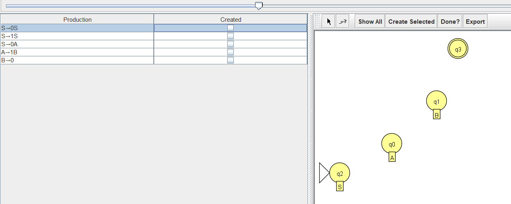
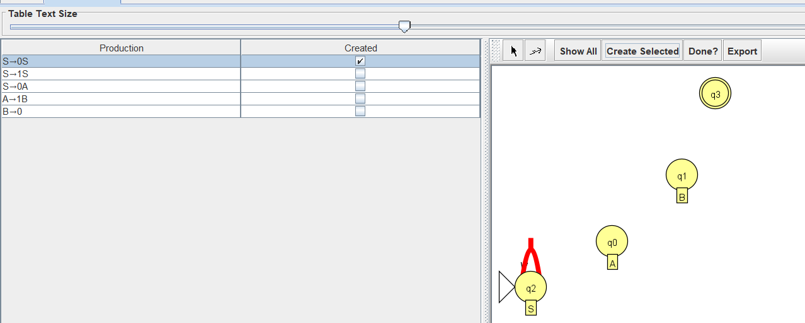
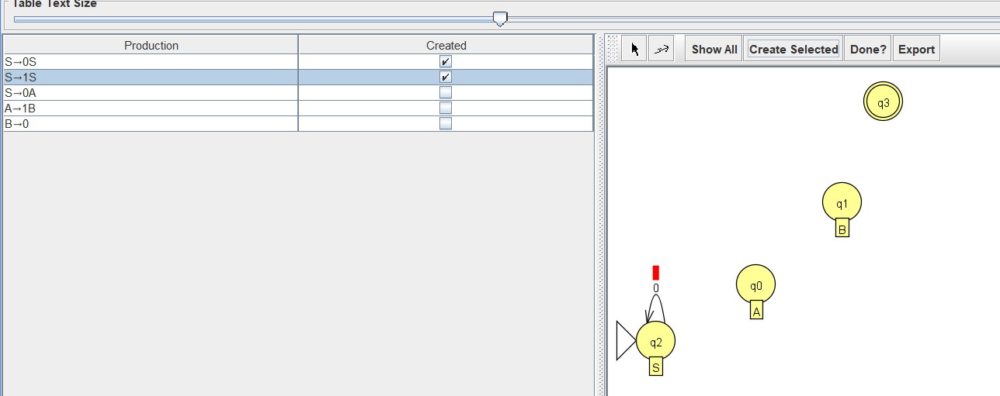
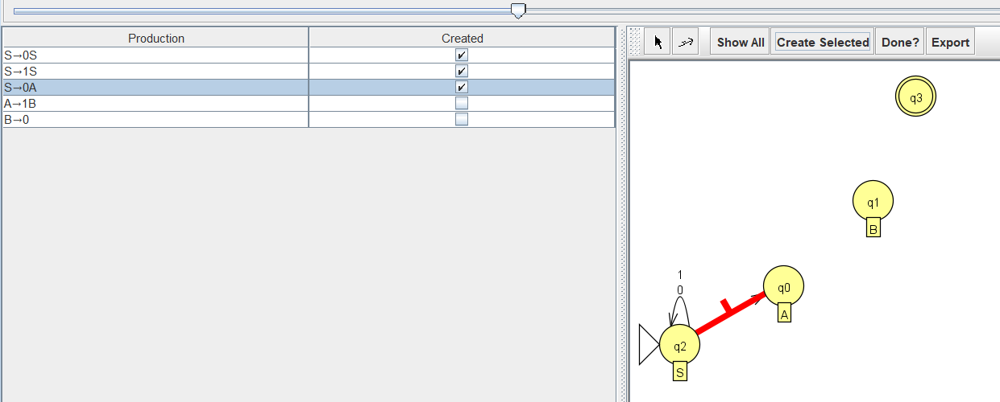
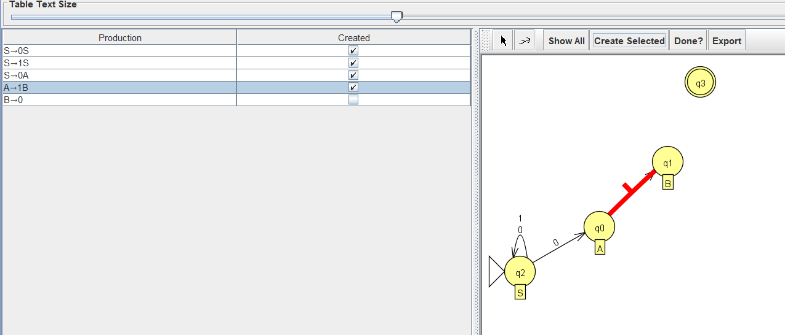
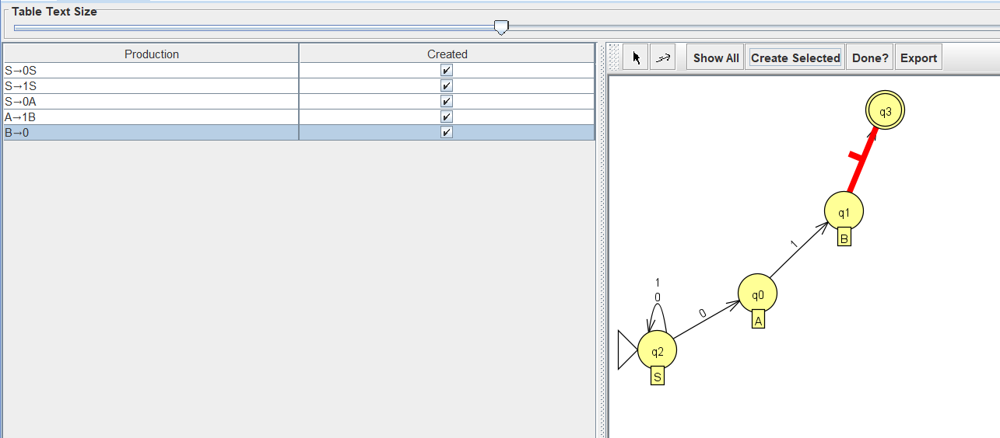

Итоговый вид полученного автомата:

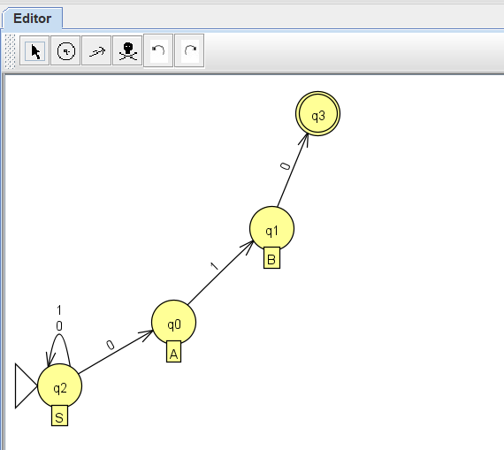

---

### 5.3. Тестирование построенного КА

Тестирование полученного автомата на том же наборе строк в Multiple Run подтвердило эквивалентность языку $L_{13}$:

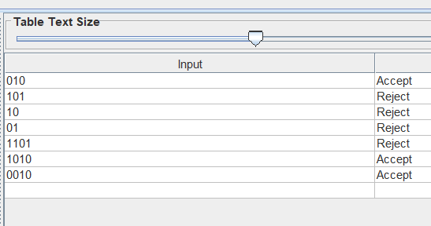

---

### 5.4. Преобразование конечного автомата в регулярное выражение (Convert FA to RE)

Обратное получение регулярного выражения выполнено методом последовательного исключения состояний (State Collapser):

1. **Объединение параллельных переходов:** кратные дуги между состояниями заменяются одной дугой с объединением символов (например, переходы по $b$ и $\lambda$ объединяются в $b+\lambda$):

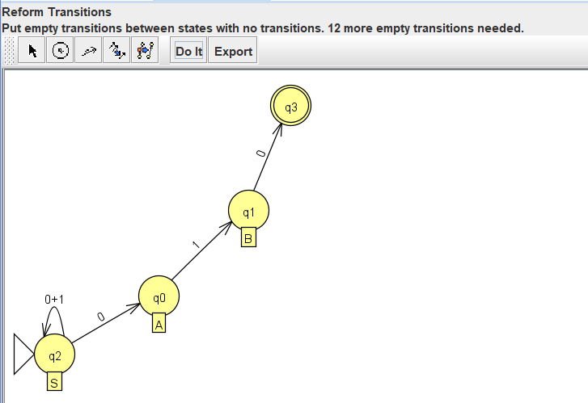

2. **Добавление недостающих переходов:** между всеми несоединенными вершинами добавляются переходы по пустому множеству $\emptyset$ (кнопка _Complete_):

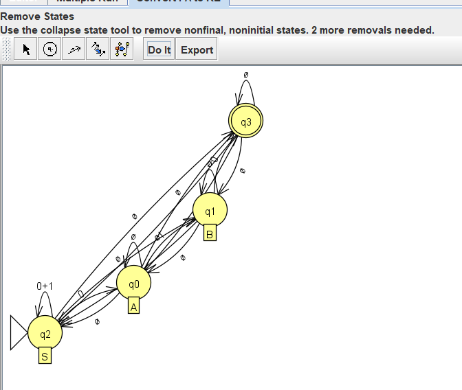

3. **Последовательное исключение промежуточных состояний:** при удалении каждой вершины пересчитываются регулярные выражения на проходящих через нее путях:

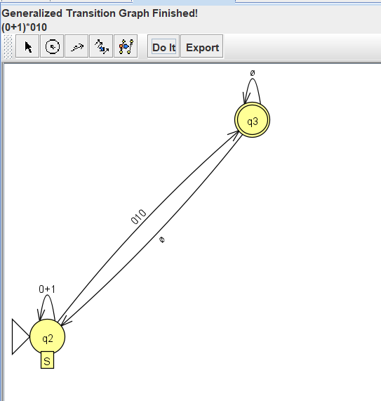

4. **Полученное регулярное выражение:**  
   После исключения всех промежуточных состояний получено эквивалентное выражение:
   $$(0+1)^*010$$

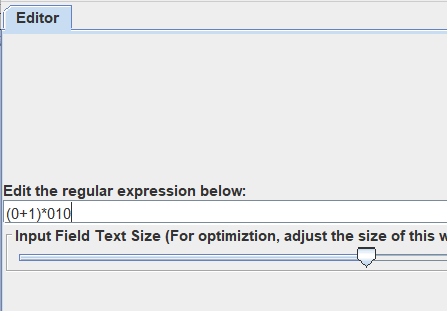

---

## 6. Часть 3. Доказательство нерегулярности языка (Pumping Lemma)

**Исследуемый язык:**
$$L_{39}​=\{0^n1^m2^n∣n,m≥0\}$$

Докажем нерегулярность языка $L_{39}$ методом от противного с использованием леммы о разрастании для регулярных языков.

**Предположим**, что $L_{39}$ регулярен. Тогда существует константа $p$ (длина накачки).

Выберем слово
$$w=0^p1^p2^p∈L_{39}​$$
Очевидно, $∣w∣≥p$.

По лемме о разрастании $w=xyz$, где:

1. $∣y∣≥1$,

2. $∣xy∣≤p$,

3. $xy^iz∈L_{39}​$ для всех $i≥0$.

Так как $∣xy∣≤p$, подстрока $xy$ целиком лежит в первой части строки $0^p$. Следовательно, y состоит только из нулей ($y=0^k, k>0$).

Рассмотрим $i=0$: строка $xz$ имеет вид $0^{p−k}1^p2^p$. Количество нулей в начале уменьшилось, но количество двоек осталось прежним. Значит, $xz∉L_{39}$​, так как в языке $L_{39}$ число нулей и двоек должно быть одинаковым.

**Противоречие**. Следовательно, $L_{39}$​ не является регулярным.

**Вывод:** предположение неверно, язык $L_{39}$ не является регулярным.

---

## 7. Заключение

В ходе лабораторной работы на практике освоены взаимные преобразования между регулярными выражениями, конечными автоматами и регулярными грамматиками с использованием инструментов JFLAP. Правильность работы построенных автоматов подтверждена прогонами на контрольных наборах цепочек. С помощью леммы о разрастании аналитически доказана нерегулярность исследуемого языка, а также на практике в среде JFLAP продемонстрирован механизм опровержения регулярности языка путем нахождения противоречия при накачке.
