# Отчет по лабораторной работе №3

**Тема:** Автоматы с магазинной памятью, контекстно-свободные грамматики и свойства контекстно-свободных языков в среде JFLAP  
**Вариант:** 14  
**Выполнил:** Козелков Дмитрий Игоревич КИ24-16/1Б

---

## 1. Цель работы

Исследование автоматов с магазинной памятью, контекстно-свободных грамматик и свойств контекстно-свободных языков, а также доказательство принадлежности языков к классу контекстно-свободных.

---

## 2. Постановка задач

1. **Часть 1:** Необходимо с использованием системы JFLAP, построить МПА,
   предназначенный для распознавания заданного языка, либо формально
   доказать невозможность этого. Если не оговорено особо, то алфавитом является
   набор {a, b, c}. Запись ns(w) означает количество символов s в цепочке w.
   Предложить программную реализацию МПА.

2. **Часть 2:** Необходимо с использованием системы JFLAP, построить
   контекстно-свободную грамматику, описывающую заданный язык, который
   может быть распознан алгоритмом перебора или управляемым пользователем,
   или формально доказать невозможность этого.

3. **Часть 3:** Доказать формально контекстно-свободность либо ее отсутствие
   заданных языков. Для доказательства рекомендуется использовать лемму о
   разрастании контекстно-свободных языков

---

## 3. Структура файлов проекта

- `1.jff` — конфигурация автомата с магазинной памятью (МПА) для языка $L_{14}$ (Часть 1)
- `2.jff` — контекстно-свободная грамматика (КСГ) для языка $L_{30}$ (Часть 2)

---

## 4. Часть 1. Автомат с магазинной памятью (МПА)

### 4.1. Логика работы автомата и критерий допуска

Язык $L_{14}$ = $\{a^nb^n: n \ge 0\}$ U $\{a\}$. Количество состояний МПА должно быть меньше 4.

**Критерий принятия цепочек:** по заключительному (финальному) состоянию ($L(P)$).

### 4.2. Граф переходов МПА

Формально автомат с магазинной памятью определяется как семерка компонентов:
$$P = (Q, \Sigma, \Gamma, \delta, q_0, Z_0, F)$$

где:

- $Q = \{q_0, q_1, q_2\}$ — конечное множество состояний;
- $\Sigma = \{a, b\}$ — алфавит входных символов;
- $\Gamma = \{X, Z\}$ — конечный алфавит магазинных (стековых) символов;
- $\delta$ — функция переходов;
- $q_0$ — начальное состояние ($q_0 \in Q$);
- $Z_0 = Z$ — начальный магазинный символ (маркер дна магазина);
- $F = \{q_2\}$ — множество заключительных состояний.

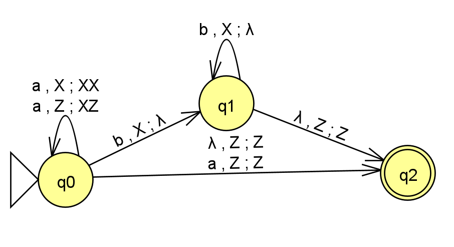

### 4.3. Пошаговое выполнение процесса распознавания (Step with State)

Пошаговая трассировка автомата в среде JFLAP на цепочке `aabb`:
23
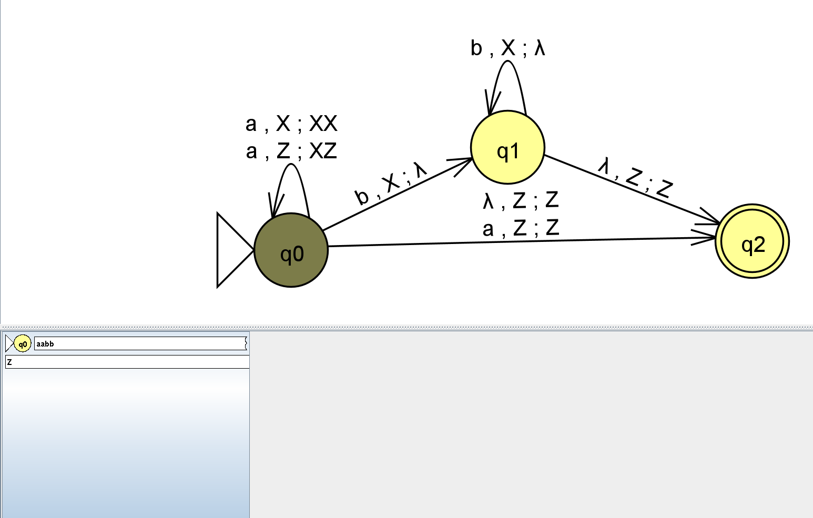
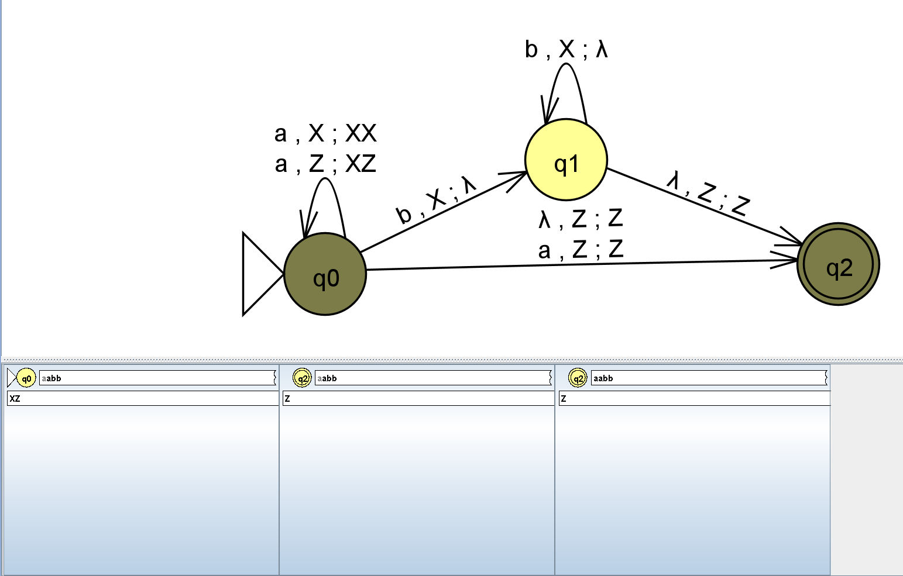
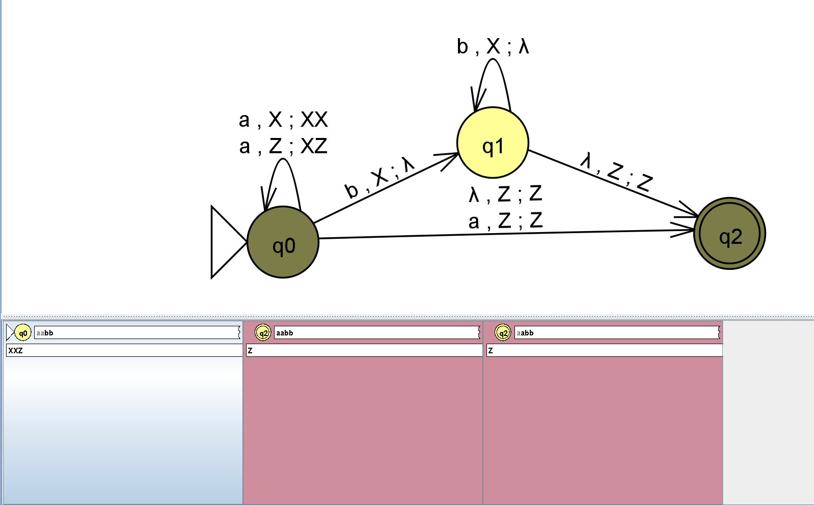
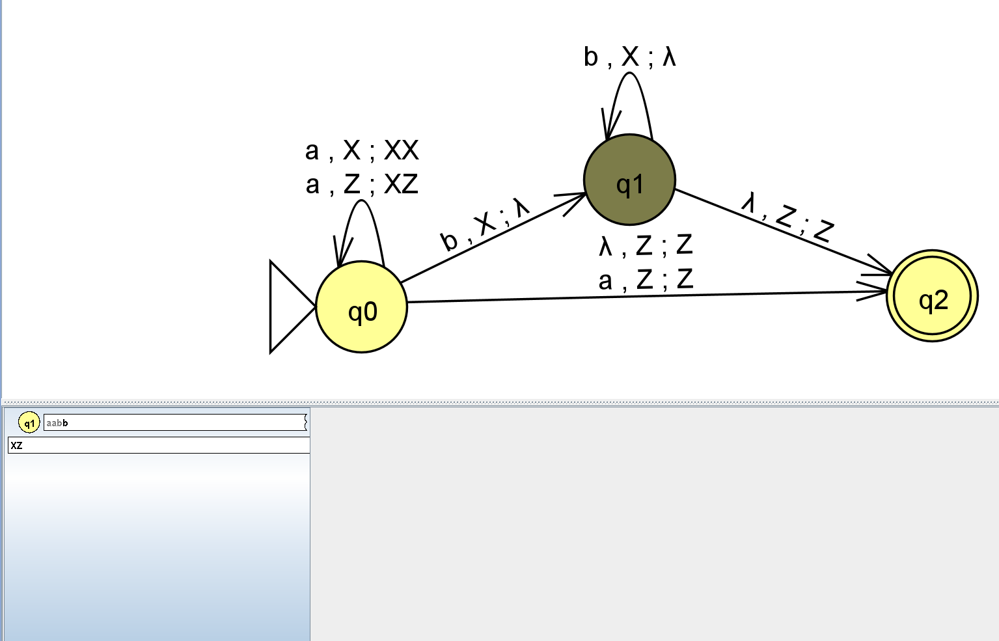
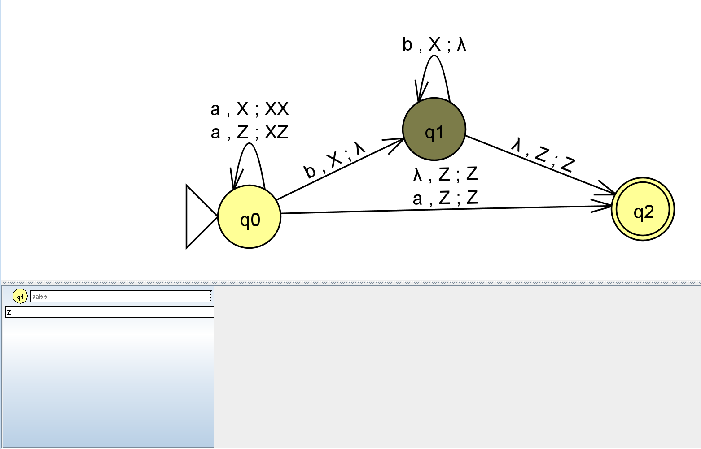
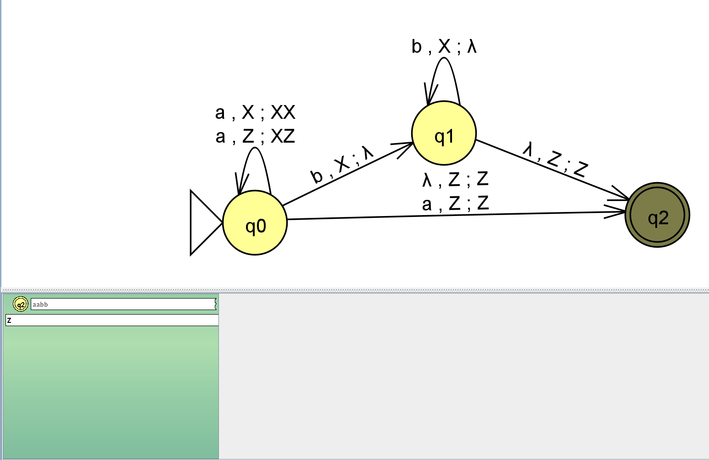

### 4.4. Верификация МПА (Multiple Run)

Автомат протестирован в режиме **Input -> Multiple Run** на цепочках, принадлежащих и не принадлежащих языку:

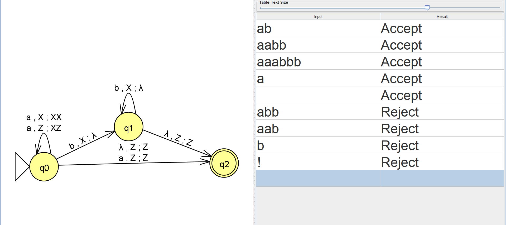

## 5. Часть 2. Контекстно-свободная грамматика (КСГ)

### 5.1. Анализ языка и схема правил

Язык $L_{30} = \{a^nb^mc^k : k ≠ n + m, m ≥ 0, n ≥ 0, k ≥ 0\}$

Удобно разбить язык на три части:
$L_{30}$ = $L_1∪L_2∪L_3$,

где
$$L_1=\{a^nb^mc^k∣k<n\},$$
$$L_2=\{a^nb^mc^k∣n≤k<n+m\},$$
$$L_3=\{a^nb^mc^k∣k>n+m\},$$

Их объединение в точности даёт k≠n+m.

Начальный символ: S.
$$S→L∣M∣R$$

Часть $k<n$
$$L→aL∣aE$$
$$E→aEc∣B$$
$$B→bB∣\lambda$$

Часть $n≤k<n+m$
$$M→aMc∣X$$
$$X→bX∣bY$$
$$Y→bYc∣\lambda$$

Часть $k>n+m$
$$R→FC$$
$$F→aFc∣T$$
$$T→bTc∣\lambda$$
$$C→cC∣c$$

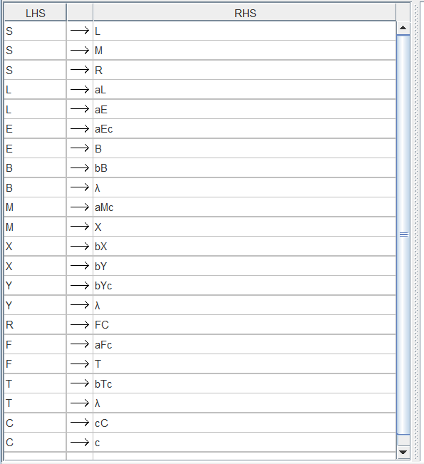

### 5.2. Тестирование КСГ (Brute Force Parse)

Тестирование выполнено через модуль **Input $\to$ Brute Force Parse** для нескольких цепочек:

Цепочка $aabbccc$:

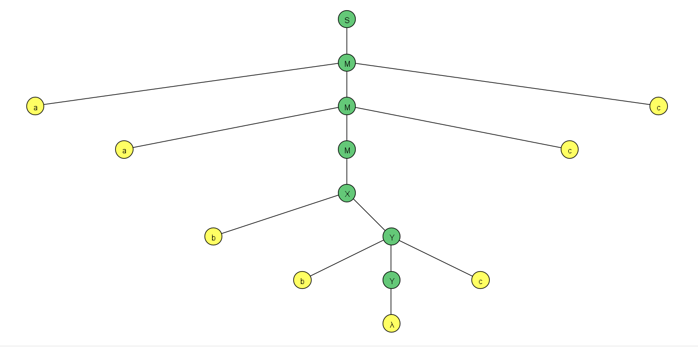

Цепочка $abccc$:

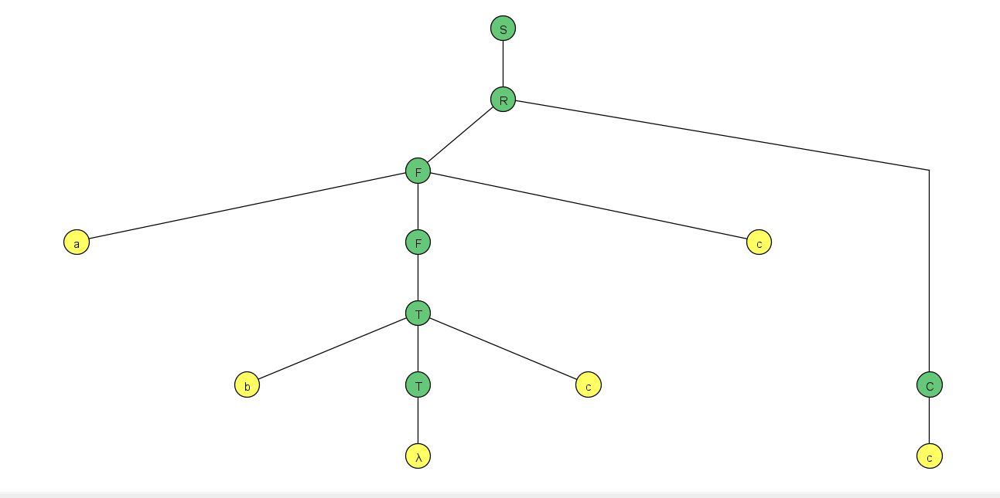

### 5.3. Тестирование КСГ (Multiple Brute Force Parse)

Тестирование выполнено через модуль **Input $\to$ Multiple Brute Force Parse**:

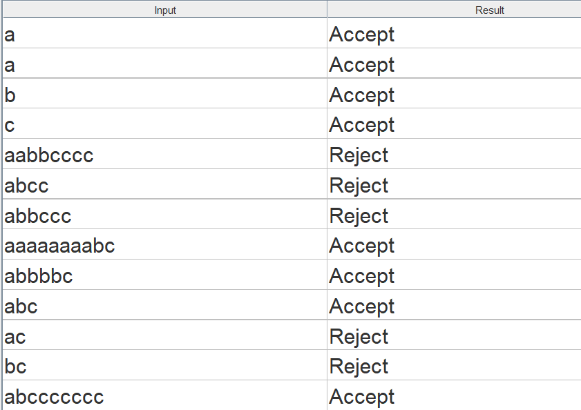

## 6. Часть 3. Исследование контекстно-свободности языка $L_{46}$

### 6.1. Формулировка задачи

Задан язык над алфавитом $\Sigma = \{a, b, c\}$:

Язык $L_{46} = \{a^nb^nc^j:n≤j\}$

Требуется доказать принадлежность либо непринадлежность данного языка к классу контекстно-свободных языков (КСЯ).

### 6.2. Теоретическое доказательство контекстно-свободности

#### Лемма о разрастании для КС-языков

Если L — КС-язык, то существует такая константа p≥1, что любое слово $w∈L$ длины $∣w∣≥p$ можно представить в виде
$$w=uvwxy,$$

где

1. $∣vwx∣≤p$,
2. $∣vx∣≥1$,
3. $uv^iwx^iy∈L$, для $i≥0$.

#### Доказательство от противного

Предположим, что L\_{46}​ контекстно-свободен. Пусть p — константа разрастания из леммы.

Рассмотрим слово
$$s=a^pb^pc^p$$

Оно принадлежит $L_{46}$​, так как здесь $n=p$, $j=p$ и выполнено $n≤j$.

По лемме о разрастании
$$s=uvwxy$$

Так как $∣vwx∣≤p$, подцепочка $vwx$ не может содержать одновременно символы $a$ и $c$: между блоками $a^p$ и $c^p$ стоит блок $b^p$, поэтому расстояние слишком велико. Значит, возможны следующие случаи.

1. $vwx$ лежит целиком в блоке $c^p$
   Тогда при $i=0$ удаляется хотя бы один символ $c$, а количество $a$ и $b$ остаётся равным $p$. Получаем слово
   $$a^pb^pc^{p−r},r≥1$$
   Условие $n≤j$ нарушено. Слово не принадлежит $L_{46}$.

2. $vwx$ лежит целиком в блоке $a^p$
   При $i=2$ увеличивается количество символов $a$, а количество $b$ остаётся равным $p$. Равенство $a$- и $b$-блоков нарушается, значит, слово не принадлежит $L_{46}$​.

3. $vwx$ лежит целиком в блоке $b^p$
   Аналогично: при $i=2$ количество $b$ становится больше $p$, а количество $a$ остаётся $p$. Равенство нарушается, слово не принадлежит $L_{46}$​.

4. $vwx$ пересекает границу $b^pc^p$

   То есть $vwx$ содержит символы $b$ и $c$, но не содержит $a$.

   Рассмотрим $i=0$.

   Если при удалении $v$ и $x$ удаляется хотя бы один символ $b$, то количество $b$ становится меньше $p$, а количество $a$ остаётся $p$. Равенство $a$- и $b$-блоков нарушается.

   Если символы $b$ не удаляются, то удаляется хотя бы один символ $c$. Тогда количество $c$ становится меньше $p$, а количество $a$ остаётся $p$. Условие $n≤j$ нарушается.

   В обоих случаях получаем слово не из $L_{46}$

5. $vwx$ пересекает границу $a^pb^p$

   То есть $vwx$ содержит символы $a$ и $b$, но не содержит $c$.

   Рассмотрим $i=2$. Пусть $α$ — число символов $a$ в $vx$.

   Если $α>0$, то количество $a$ становится больше $p$, а количество $c$ остаётся равным $p$. Тогда $j=p<n$, что нарушает условие $n≤j$.

   Если $α=0$, то $vx$ состоит только из символов $b$, поскольку $∣vx∣≥1$. Тогда количество $b$ увеличивается, а количество $a$ остаётся $p$. Равенство $a$- и $b$-блоков нарушается.

   Снова получаем слово не из $L_{46}$​.

#### Противоречие

Во всех возможных случаях представления $s=uvwxy$ нашёлся такой индекс $i$, что слово $uv^iwx^iy$ не принадлежит $L_{46}$. Это противоречит лемме о разрастании.

Следовательно, предположение о контекстно-свободности $L_{46}$​ неверно.

---

## 7. Заключение

В ходе выполнения лабораторной работы исследованы принципы функционирования автоматов с магазинной памятью и механизмы порождения языков контекстно-свободными грамматиками.
